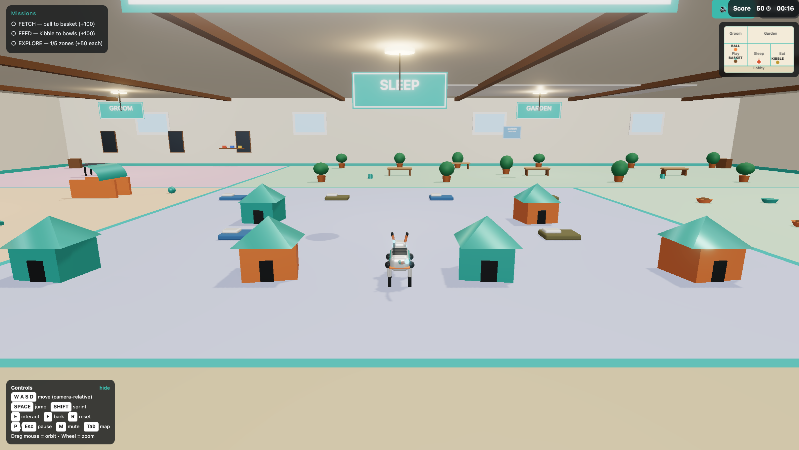
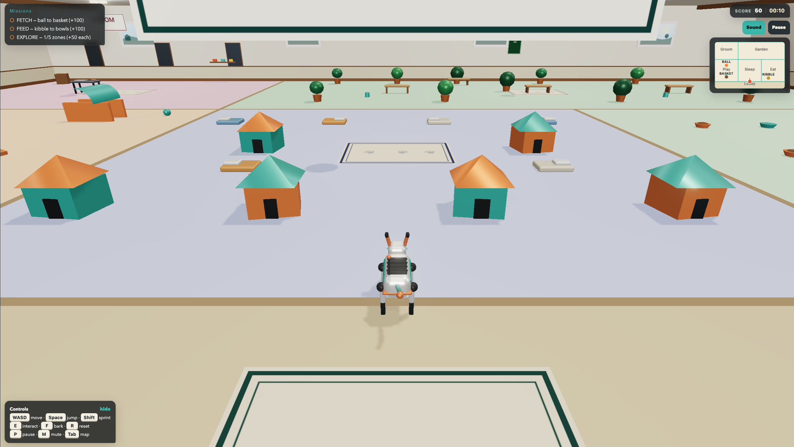

# Robot Dog Shelter — 3D Simulator

A polished, playable 3D robotic dog simulator with a third-person MMORPG-style camera,
inside a large indoor dog shelter. Vanilla JavaScript + Three.js + Rapier.
No CDN game assets, no external fonts/textures/models.

▶ **Play live:** https://robot-shelter-muse.vercel.app/ (deployed on Vercel from this repo)

## Screenshots

Captured in-game by the user on their own device (camera angles differ slightly
between the two shots).

| v0 — tanpa antislop (`main`) | v1 — dengan antislop (`antislop-visual-polish`) |
|---|---|
|  |  |

What changed between the two (3D only, see `anti-slop/audit-001-2026-10-15.md`):
cream signs + dark text (contrast 8.7–10.6:1, was 2.17), wood-plank floor +
paw-print rugs, wainscot + wood rails, windows with an outdoor view, alternating
roof/bed colours, per-zone light moods, glow kept on visor + core only.
Gameplay is identical.

## Tech stack (exact, pinned in `package.json`)

| Dependency | Version |
|---|---|
| three | 0.186.1 |
| @dimforge/rapier3d-compat | 0.21.0 |
| vite (dev + build) | 8.3.4 |
| Node | 20 LTS (tested on Node 24) |

Rendering: WebGL2, MeshStandardMaterial PBR, ACESFilmic tone mapping (exposure 1.1),
sRGB output, PCFSoft shadows, RoomEnvironment reflections (no HDR file), subtle
UnrealBloom (threshold 0.85, strength 0.25, auto-disabled under load).

## Run locally

```bash
npm install
npm run dev      # dev server → http://127.0.0.1:5173
npm run build    # production build
npm run preview  # serves the build → http://127.0.0.1:4173
```

Open the URL, click **Click to Play** (unlocks audio), then **Play Missions** or **Free Roam**.

## Controls

| Input | Action |
|---|---|
| W A S D / Arrow keys | Move relative to camera |
| SPACE | Jump (grounded only, coyote 0.1s, jump buffer 0.15s) |
| SHIFT (hold) | Sprint 1.6×, FOV +4 |
| Mouse drag (left or right) | Orbit camera (yaw 360°, pitch −5°…55°) |
| Mouse wheel | Zoom 3.5–12m |
| E | Interact / pick up / drop |
| F | Bark (animation + sound + camera shake) |
| R | Reset dog to spawn |
| P / Esc | Pause / resume |
| M | Mute / unmute (persists in localStorage) |
| Tab | Toggle minimap |
| Touch | Left joystick = move, right drag = orbit, buttons = Jump / Sprint / E / Bark |

## Gameplay

- **Sandbox / Free Roam:** explore freely.
- **Missions (5–10 min total):**
  1. **FETCH** — pick up the orange ball in the Play Zone (E), bring it to the basket. +100
  2. **FEED** — pick up the kibble bag in the Eat Zone (E), bring it to the food bowls (E). +100
  3. **EXPLORE** — visit all 5 zones: Play, Sleep, Eat, Groom, Garden. +50 each
- All missions complete → Completion screen with time + score, **Play Again** + **Free Roam**.

## Architecture

```
index.html                  UI overlay: loading, menu, HUD, pause, completion, touch, minimap
src/main.js                 Boot, WebGL2 check, error handling
src/game/Game.js            State machine LOADING / MENU / PLAYING / PAUSED / COMPLETE,
                            renderer, loop, fixed-timestep physics, auto-quality, bloom
src/game/Input.js           Keyboard + mouse + touch, edge-triggered actions, no listener leaks
src/game/Player.js          Dog movement, jump, grounded, turn lerp, visual sync
src/game/CameraRig.js       MMORPG camera: follow, orbit, zoom, raycast collision, shake
src/game/Physics.js         Rapier world, colliders, raycasts, grounded check
src/game/Missions.js        Objectives, scoring, pickup/carry/drop, completion
src/world/Shelter.js        Floor, walls, windows, ceiling/skylight, zone signs, info board
src/world/Props.js          Houses, beds, toys, ramps, bowls, plants… (InstancedMesh repeats)
src/world/RobotDog.js       Procedural dog + rig + blended animations
src/ui/HUD.js               HUD, minimap, toasts, pause, completion
src/audio/Audio.js          WebAudio synth SFX + ambient, mute persisted
src/utils/constants.js      All tuned numbers (physics, camera, zones, dog)
src/utils/helpers.js        Canvas textures, signs, dust-puff pool
```

## Exact numbers implemented

- Shelter 60m × 40m (x −30…30, z −20…20), walls 6m. Spawn (0, 0, 14) facing north (−z).
- Physics: gravity −22, walk 4.5 m/s, sprint 7.2 m/s, jump velocity 8.2 m/s (~1.5m),
  air control 0.6×, accel 40, decel 50, turn lerp 12/s, fixed timestep 1/60 (max 3 substeps),
  delta clamp 0.033. Dog capsule radius 0.35, half-height 0.35, fixed rotation.
  Grounded = downward raycast + contact normal Y > 0.7.
- Camera: default distance 7m, min 3.5m, max 12m, wheel step 0.5m, zoom lerp 10/s,
  pitch −5°…55°, FOV 55 (58 sprinting), target dog head + 1.2m, follow lerp 8/s,
  collision raycast pulls camera to hit + 0.3m, min y 0.4m, orbit 0.35°/px, damping 8/s.
  Shake only on landing (0.08s, 0.05m) and bark (0.05s).
- Dog: body ~0.9m, shoulder ~0.55m, 4 articulated legs, 2 ears + jaw, 3-segment tail,
  antenna + glowing chest core. Painted metal (metalness 0.6, roughness 0.35),
  white + teal + orange, emissive cyan eyes/core. Blend crossfade 0.15s.
  Stride length scales with speed so feet do not slide.

## Performance

- Shared geometries/materials + InstancedMesh for repeated props (houses, beds, bowls,
  plants, balls, crates, benches, fences, ceiling lights).
- Draw calls ≈ 70–90 (target < 120), triangles well under 150k.
- Shadows: sun (2048 map) + 2 nearest point lights only; other 4 point lights no shadows.
- DevicePixelRatio capped at 2, antialias on.
- Auto-quality: if FPS < 45 for 3s while playing, drops to Medium
  (shadow 1024, bloom off, pixelRatio ≤ 1.5). Manual Low/Medium/High in pause menu.

## Audio

All synthesized with WebAudio — no external files, no autoplay before a user gesture:
bark (square + noise), jump whoosh, land thud, pickup chime, mission jingle,
ambient brown-noise room tone + occasional distant bark.

## Verification

```bash
npm install && npm run build
npm run preview   # then open http://127.0.0.1:4173
```

Verification performed at build time: `npm run build` passes, `npm run preview`
serves HTTP 200 with the game canvas. Interactive playtest (movement, missions,
camera, touch) is intentionally left for a live-browser check — see acceptance
criteria in the project brief; nothing about playtest is claimed from the HTTP check.

## Notes / known limits

- Originally local / preview only by design (see the original build prompt below);
  published to GitHub + Vercel in Oct 2026 by user decision.
- The dog cannot climb ramps by walking (no step-up logic); ramps are low platforms
  the dog can jump onto, and the tunnel is walk-through.
- Fences along the lobby wall are decorative; the real boundary is the Rapier
  perimeter walls, so the dog can never leave the shelter or fall through the floor.
- Pickup items (ball, kibble bag) are visual + proximity logic, deliberately not
  physics bodies, so carrying never fights the physics solver.

## Original build prompt

The prompt used to build this game, reproduced verbatim (2026-10-15).

> Note: its §12/§13 no-deployment rule was the original constraint. It was later
> superseded when the user chose to publish the game via GitHub + Vercel.

<details>
<summary>Click to expand the full prompt</summary>

```
You are a Senior Three.js Engineer, 3D Game Developer, Technical Artist, and DevOps Engineer.
You build production-ready, playable web games — not demos, not mockups, not placeholder scenes.
If a feature cannot be made fully working, you say so explicitly and do NOT ship it as fake.

## 1. MISSION — DONE STATE
Build a polished, playable 3D robotic dog simulator with a third-person MMORPG-style camera,
inside a large indoor dog shelter. The game must run locally in a modern desktop browser with zero
console errors. NO public deployment — local run + preview only.

Done means ALL of this is true:
- User can run `npm run dev` or `npm run preview`, open localhost, click Play, and immediately control the dog with no setup.
- Movement, jump, sprint, camera orbit/zoom, collisions, missions, HUD, pause, and restart all work.
- No placeholder boxes, no grey untextured primitives, no dead buttons, no fake UI.
- `npm run build` passes, `npm run preview` serves the game, and the local build loads in < 3s.

## 2. TECH STACK (pin exact versions in package.json and list them in README)
- Three.js (latest stable) via ES Modules + import map / Vite bundling
- Vanilla JavaScript ES Modules — NO React, React Three Fiber, Vue, Angular, or any frontend framework
- Vite (dev + build only), Node 20 LTS
- Rapier Physics for JavaScript (@dimforge/rapier3d-compat — JS build, no custom WASM pipeline)
- HTML5 + CSS3, WebGL2 (with a clear fallback message if WebGL2 is unavailable)
- No CDN hotlink for game assets. All models/textures/code are same-origin in the repo.

## 3. ARCHITECTURE — clean, modular, maintainable
Use this file structure (or equivalent, documented in README):
src/
  main.js (boot, loop, resize, error handling)
  game/Game.js (state machine: LOADING / MENU / PLAYING / PAUSED / COMPLETE)
  game/Input.js (keyboard + mouse + touch, no per-frame listeners leak)
  game/Player.js (dog movement, jump, grounded state, animation blending)
  game/CameraRig.js (MMORPG camera: follow, orbit, zoom, collision)
  game/Physics.js (Rapier world, colliders, raycasts, grounded check)
  game/Missions.js (objectives, scoring, completion)
  world/Shelter.js (floor, walls, zones, props placement)
  world/Props.js (dog houses, beds, toys, ramps, bowls, plants, etc.)
  world/RobotDog.js (procedural dog model + rig + animations)
  ui/HUD.js (health/mission HUD, minimap, help, pause, completion)
  audio/Audio.js (WebAudio synth SFX + mute, no external files required)
  utils/...
Keep functions small, no 1000-line files, no magic numbers without a named constant.

## 4. GAMEPLAY LOOP — must have a goal, not just walking
Modes:
- Sandbox: free roam.
- Missions (3, completable in 5–10 min total):
  1. FETCH: pick up the ball (walk over + press E) and bring it to the basket. +100 pts.
  2. FEED: push / carry a kibble bag to the food bowl zone, press E to fill. +100 pts.
  3. EXPLORE: visit all 5 zones (Play / Sleep / Eat / Groom / Garden). +50 pts each.
- On all missions complete: show Completion screen with time, score, Play Again + Free Roam buttons.
- Interact: E = interact/pickup/drop, F = bark (with animation + sound + small camera shake), R = reset dog to spawn, P / Esc = pause.

## 5. CONTROLS — exact, must all work
| Input | Action |
| W A S D / Arrow keys | Move relative to camera direction |
| SPACE | Jump (only when grounded, coyote time 0.1s, jump buffer 0.15s) |
| SHIFT (hold) | Sprint (1.6x speed, FOV +4, run animation) |
| Mouse drag (hold left) / Right-drag | Orbit camera (yaw + pitch) |
| Mouse wheel | Zoom camera distance |
| E | Interact / Pickup / Drop |
| F | Bark |
| R | Reset to spawn |
| P / Esc | Pause / Resume |
| M | Mute / Unmute |
| Touch (mobile fallback) | Left virtual joystick = move, right drag = orbit, buttons = Jump / Sprint / Interact / Bark |
Smooth movement: acceleration 40 m/s², deceleration 50 m/s², turn lerp 12/s. No instant snapping.

## 6. ROBOTIC DOG — original procedural model, NOT primitive placeholders
Build the dog from procedural geometry with beveled / rounded shapes, PBR materials, panel lines,
glowing eye visor, joints, and decals. It must read as a designed robot dog at 2m distance.
Specs: body length ~0.9m, shoulder height ~0.55m, 4 articulated legs (upper + lower + paw),
head with articulated ears (2) + jaw, tail with 3 segments, antenna + chest core that glows.
Materials: painted metal (metalness 0.6, roughness 0.35) in white + teal + orange accents,
dark joints, emissive cyan eyes/core.
Animations (procedural, blended, no T-pose / sliding feet):
- Idle: breathing (chest scale), ear twitch every 3–6s, tail wag, head look toward movement.
- Walk: 4-beat gait, leg swing + bob, speed-synced stride.
- Run: faster gait, body lean forward 8°, tail streams back.
- Jump: legs tuck on rise, extend on fall, squash-and-stretch on land (0.12s) + dust puff.
- Bark: jaw open, head up, ears back, 0.4s.
- Interact/Pickup: head down, mouth holds ball (ball attaches to mouth socket).
Blend: crossfade 0.15s between states. Feet must not slide: stride length scales with speed.

## 7. SHELTER — large indoor playground, 60m x 40m, walls 6m high
Zones (with floor color + sign + lighting change so player always knows where they are):
1. Entrance / Lobby (spawn, info board, controls poster)
2. Play Zone (ramps, tunnels, balls, toys, agility course)
3. Sleep Zone (6 dog houses, 6 beds, night lamps)
4. Eat Zone (6 food + water bowls, kibble station, feeding table)
5. Groom Zone (grooming table, mirrors, brushes shelf)
6. Indoor Garden (plants, benches, skylight, watering cans)
Props (all placed with colliders, none floating, none intersecting walls):
dog houses x6, fences, windows (with outdoor glow), 2 doors, beds x6, toys (balls x8, rope x3, frisbee x2),
ramps x3, food bowls x6, water bowls x6, plants x12, ceiling lights, wall posters, benches x4, crates x5.
Boundary: invisible walls + visible low fence so dog cannot leave the shelter or fall through floor.
Spawn: (0, 0, 14) facing north toward Play Zone.

## 8. CAMERA — third-person MMORPG style, exact numbers
- Default distance 7m, min 3.5m, max 12m, wheel step 0.5m, smooth zoom lerp 10/s.
- Yaw: free 360°, Pitch: clamp -5° to 55°, FOV 55 (58 when sprinting).
- Follow: camera target = dog head + (0, 1.2m, 0), position lerp 8/s, no jitter.
- Collision: raycast from target to desired camera pos each frame; if blocked by wall/prop, pull camera in to hit point + 0.3m. Never clip through walls. Never go below floor (min y = 0.4m).
- Orbit: drag sensitivity 0.35°/px, inertia damping 8/s. Camera rotation must not rotate the dog unless moving.
- Shake: only on landing (0.08s, 0.05m) and bark (0.05s). No constant shake.

## 9. PHYSICS — Rapier, exact numbers
- Gravity: -22 m/s² (game-feel, not -9.81, to make jumps snappy).
- Walk speed 4.5 m/s, Sprint 7.2 m/s, Jump velocity 8.2 m/s (jump height ~1.5m), Air control 0.6x.
- Dog collider: capsule (radius 0.35m, height 0.7m), fixed rotation, no tipping.
- Ground check: raycast down 0.15m + Rapier contact. Grounded = true only if contact normal Y > 0.7.
- All props have matching colliders (boxes/capsules). No walking through houses/walls/bowls.
- Fixed timestep 1/60, max 3 substeps. Delta clamped to 0.033s.

## 10. RENDERING + ART DIRECTION
Style: Stylized cartoon, premium game-like — like a cozy Pixar / Animal Crossing interior, NOT realistic, NOT flat grey.
Palette: warm cream walls #F5EEDD, wood floor #C89B6A, teal accents #2EC4B6, orange #FF8C42, soft sky skylight #BFE8FF.
Lighting: warm hemisphere + 1 directional sun through skylight (soft shadows, 2048 map) + 6 warm point lights in zones.
Materials: MeshStandardMaterial PBR. Tone mapping ACESFilmic, exposure 1.1, outputColorSpace SRGB.
Shadows: PCFSoft, only sun + 2 nearest lights cast shadows. Bloom: subtle (threshold 0.85, strength 0.25) if it stays >55fps, else auto-disable.
Environment: simple RoomEnvironment for reflections (no HDR file dependency).
Performance budget (must meet on M1 MacBook Air / GTX 1660 laptop):
- 60fps at 1080p, <150k triangles, <120 draw calls, <80MB textures, load <3s.
- Auto quality: if fps <45 for 3s, reduce shadow map to 1024 + disable bloom + reduce pixelRatio to 1.
- DevicePixelRatio capped at 2. Antialias true.

## 11. UI / HUD / AUDIO
- Loading screen: progress bar + tip, then "Click to Play" (needed for pointer lock / audio unlock).
- HUD: top-left mission tracker (3 checkboxes), top-right score + time + mute + pause, bottom-left controls hint (collapsible), bottom-right action buttons (Jump / Interact / Bark) on touch.
- Minimap: top-right small canvas, dog dot + zone labels + mission markers. Toggle with Tab.
- Pause menu: Resume / Restart / Controls / Quality (Low/Med/High) / Main Menu. Esc closes.
- Audio: WebAudio synthesized (no external files): bark (square + noise burst), jump whoosh, land thud, pickup chime, mission complete jingle, ambient room tone (low brown noise + occasional distant bark). Mute persists in localStorage. No autoplay before user gesture.
- Fonts: system font stack only (no webfont download required). No external font CDN.

## 12. LOCAL RUN / PREVIEW ONLY — NO DEPLOYMENT
- NO public deployment. Do NOT deploy to Vercel / Netlify / GitHub Pages. Do NOT create a live URL.
- Repo: single local project, README with how to run, controls, and tech stack.
- Commands: `npm install`, `npm run dev`, `npm run build`, `npm run preview` must all work from clean clone.
- Verification: run `npm run build` + `npm run preview`, open the local preview URL, and confirm the game loads and is playable.
- Deliver: a 30s screen recording / GIF or 3 screenshots (menu, gameplay, missions complete) + verification checklist + exact local commands used.

## 13. DO NOT
- Do NOT use React / R3F / Vue / Angular.
- Do NOT ship fake features, dead buttons, placeholder grey boxes, or "coming soon" screens.
- Do NOT use random external GLTF / textures from the internet. All assets are procedural + code-generated in-repo.
- Do NOT hotlink CDN assets for gameplay (only npm deps).
- Do NOT deploy and do NOT invent a live URL. Local / preview only.
- Do NOT auto-play audio before user interaction.
- Do NOT let the camera clip through walls or the dog fall through the floor.

## 14. ACCEPTANCE CRITERIA — verify each, report pass/fail
1. Loads with no console errors, loading → menu → play works.
2. WASD moves relative to camera, Shift sprints, Space jumps + lands, no double-jump.
3. Camera orbits 360°, zooms 3.5–12m, never clips walls, smooth follow.
4. Dog collides with all houses/walls/bowls, cannot leave shelter or fall through.
5. All 3 missions completable, score updates, completion screen shows.
6. Animations blend (idle/walk/run/jump/land/bark) with no sliding feet or T-pose.
7. Pause, restart, mute, reset, and quality toggle all work.
8. 60fps target on stated hardware, auto-quality kicks in if needed.
9. Mobile touch controls work (move + orbit + jump + interact).
10. Build from clean clone + local preview (`npm run preview`) both verified. No deployment required.

## 15. WORKFLOW
Build in this order, verify each step before moving on:
1. Scaffold + empty shelter floor + dog capsule that moves + camera.
2. Full dog model + animations + physics + camera collision.
3. Full shelter + props + colliders + zones.
4. Missions + HUD + audio + pause + minimap.
5. Polish (lighting, bloom, particles, screens) + performance pass + local preview verification (`npm run build` + `npm run preview`). No deploy.
After each step, list what was verified and what is still missing. Do not claim a step is done until it is tested in the running build.
```

</details>
